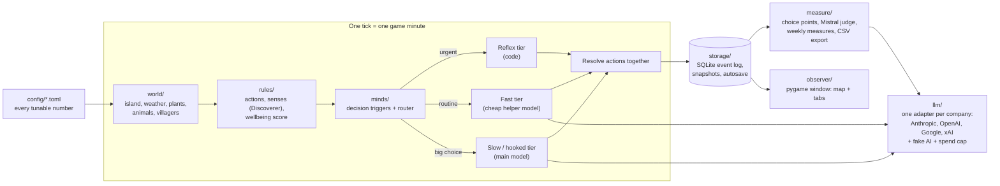

# AI Playground

A Python simulation in which four AI players (Claude, GPT, Gemini and Grok) live on a pixel-art island with limited resources, so I can watch how their values form and change under scarcity.

Inside the code, the game itself is called AI Island (Python package `ai_island`).

## Why I built it

I had been reading a lot of articles on how AI is causing several cyber security issues. I wanted to see what would happen if I gave AIs a value system and an environment to live in: would they turn to malicious acts, or cooperate?

## What it does

What works today. Each item has passing automated tests, except where marked.

- **A living island, no AI needed.** An 80 × 80 tile island with seasons, weather, plants that regrow, animals that breed and can be hunted out, and wild dogs. The same seed always gives exactly the same history.
- **The whole game, played by rule-based players.** Hunger, thirst, cold, rest, sickness and injury; a hidden wellbeing score that players feel only as words; death and respawn at home; 3 villagers per player who can grow loyal, leave or die; 39 actions, each lasting a set amount of game time; land claims, task stages and rewards; senses (sight and hearing ranges), so players only know what they see or hear.
- **An observer window** (pygame) with a top bar (clock, season, pause/resume, speed, spending, autosave) and tabs for chats, choice points, world history, players and spending. It also has an inspector with graphs of wellbeing, trust and anger, event flashes, a mini-map, and a plain-language guide to every command (`docs/guide.md`).
- **Run control.** Pause and resume across days, autosave, crash recovery that replays to the same state, and CSV export of every table.
- **AI players.** Each player has a ranked list of 14 values, a memory, and three ways of deciding: code reflexes for urgent needs, a cheap helper model for routine moves, and its main model for big choices. A stressed ("hooked") player decides with less help and fewer memories. Every big decision is saved as a "choice point".
- **One connection layer for five AI companies** (Anthropic, OpenAI, Google, xAI and Mistral). Replies are checked against a fixed format before anything happens, and every call's tokens and cost are recorded. A spending cap pauses the run before any call that would go over it.
- **A blind judge.** A Mistral model labels choice points and writes daily summaries and weekly player profiles. It never sees which company is behind a player.
- **Weekly measures.** Stated values compared with the judge's labels, stressed vs. calm "against-my-values" choices, promises made vs. kept, help vs. harm, and villager welfare.
- **Paid-step tools:** `calibrate` (matches how much each main model thinks and measures cost), `judge-check`, a pilot profile, `analyze` and `launch-check`.
- **A fake AI** that lets the whole game, AI players included, run and be tested for free.

Known problem: a 3-game-week pilot with the real AIs found game bugs that blocked most of the AI players' actions (see Status). The rule-based game and the fake-AI path run, but the live AI path isn't usable for research yet.

## Status

| | |
|---|---|
| **Works** | Build phases 1–5: the island, the game rules, the observer screen, run control and exports, the AI minds, the judge and measures, and the calibration and pilot tools ([PHASE_HISTORY.md](PHASE_HISTORY.md)) |
| **Done once** | Calibration with the real AIs (about $5.43 over the runs that finished) and a 3-game-week pilot with all four AIs: 11,528 AI calls, about $11.10 against a $2.77 estimate |
| **Pilot result** | The system ran end to end (AI calls, judge, daily and weekly summaries, spend tracking). But game bugs blocked most actions: item names in prompts didn't match what the eat and gather actions accept, players couldn't target anyone by name (so talk, trade and every action aimed at a person failed), and spoken words never reached the listener. About two out of three player decisions ended in a failed action, so the pilot says nothing yet about how the AIs behave. |
| **Not started** | Fixing those bugs and running a second pilot |
| **Planned** | Phase 6: tuning from the pilot, then the real run |

## How it works

The world advances in ticks of one game minute, like a board game played in turns. Each tick:

1. The world updates: weather, plants, animals and villagers.
2. Plain code (the "Discoverer") turns what each player can see, hear and feel into short text.
3. A player is asked for a decision only when its action ends, someone speaks to it, something interrupts it, or 2 game hours pass. A router then picks the decision tier.
4. AI calls run in parallel, and the game clock stops while any AI is thinking, so a slow model never changes the outcome.
5. Every reply is checked, actions are resolved together, and everything is written to an append-only SQLite log.

The window only displays the world. The same simulation runs headless (no window) for tests and long runs.



## Tech stack

- **Language and tooling:** Python 3.13, uv (installs Python and the dependencies), pytest, ruff, git
- **Window:** pygame-ce, pygame_gui
- **Data:** SQLite (one database per run), Pydantic (checks AI replies and config files), TOML config files
- **AI connections:** official SDKs from Anthropic, OpenAI, Google (google-genai) and Mistral; xAI through the OpenAI SDK; Ollama for a small local embedding model used in memory search; python-dotenv for API keys
- **Art:** Kenney 1-Bit Pack (colour version), Tiny Creatures and the monogram font, all CC0
- **Build system:** Claude Code (manager, coder, tester and debugger agents), Codex CLI (a second planner), PowerShell launch scripts, and an optional Node.js Telegram connector for the two planners

## My role

This project was built with AI coding assistance. I designed the system and directed the build, and AI coding agents (Claude Code and Codex) wrote the code.

**What I designed and decided**
- The research question and the players' "mind". It's based on two diagrams I drew: a values circle (Self, Values, Discoverer, Noticer, Advisor) and an ACT-style choice point (toward vs. against, hooked vs. unhooked).
- The core rules:
  - a hidden wellbeing score that players feel only as words
  - 14 values, with the top 5 as core values
  - no public chat (players talk face to face and can be overheard)
  - death with respawn
  - two poisonous plants and predators
  - no free-form "improvise" action, no villager births and no starting currency
- The research design:
  - four players from four different labs, and no Chinese-developed models
  - a judge from a fifth company that never sees which model is behind a player
  - stressed players keep the same main model but get less help, so stressed and calm choices are made by the same model
  - one run, with luck accepted as part of it
- Cost and order:
  - a $100 budget
  - everything free first, so I could watch the whole game with rule-based players before paying for any AI
  - a few large build phases instead of many small ones
- Changes after watching or testing:
  - Phase 1.5 (colour, and movement that follows the clock)
  - Phase 3.5 (observer improvements)
  - the thinking settings chosen after calibration
- Approval. I approved every merged phase plan before any code was written. After each phase I reviewed the result, and I reopened phases when something was wrong (Phase 1 round 2, Phase 5 rounds 2–8). I ran every step that cost money myself.

**What AI agents did**
- Claude helped me turn the design into the specs in `docs/` and the phase specs in `phases.md`.
- Claude Code agents wrote all the code in `src/` and the tests in `tests/`, and diagnosed failures.
- Codex wrote a second, independent plan for each phase and proposed ideas, which were adopted or rejected in each phase record.

## How it was built

The repo includes the build system itself (`.claude/`, `.agents/`, `.codex/`, `managers/`, `handoffs/`, `scripts/`). Each phase ran like this:

1. **Two blind plans.** `scripts/start-phase.ps1` opens two terminals. A Claude manager and a Codex manager each write their own plan from `phases.md` and the specs, without seeing each other's. Codex's researcher proposes up to 5 ideas, and its reviewer marks each one Keep, Reject or Maybe against the existing code.
2. **Clarify and merge.** The Claude manager can ask Codex up to 5 questions, through a Telegram group if one is set up. It then merges both plans into `handoffs/phase-N.md` with a decisions table, and lists open questions in `Questions.md`.
3. **My approval.** I read a plain-language "For Tim" summary and replied "go" or asked for changes.
4. **Rounds.** A coder agent builds the phase (two coders when it splits into separate parts). A tester agent writes tests from the numbered acceptance criteria and runs them. A debugger agent finds the cause of any failure, and the coder fixes it. The manager commits after each step and tags `phase-N-start` and `phase-N-done`.
5. **Definition of done.** Every acceptance criterion needs a passing test or command output, the full suite and lint must pass, and only the phase's planned folders may change.

Safety hooks in `.claude/hooks/` stop agents from reading the API key file, editing the build system or running destructive git commands. No agent was allowed to make a real AI call. Every paid command was run by me, with a dollar limit.

Across phases 1–5 that meant 7 phase specs with 140 numbered acceptance criteria, 54 commits over five days (1–5 November 2026), and 1,149 automated test cases. [PHASE_HISTORY.md](PHASE_HISTORY.md) has the details for each phase.

## Getting started

**Prerequisites**
- Windows, macOS or Linux. It was built on Windows. The commands below were checked on Linux, in a fresh copy of this folder.
- [uv](https://docs.astral.sh/uv/). It installs Python 3.13 and every dependency.
- Only for paid runs: API keys for the five companies, and [Ollama](https://ollama.com) running with the `nomic-embed-text` model.

**Install**
```
git clone https://github.com/tdamelin2/AI-Playground.git
cd AI-Playground
uv sync
```
✅ Tested.

**Configure (only for paid runs)**

Copy `.env.example` to `.env` and paste your keys. Nothing else needs keys: the rule-based game, the fake AI and the tests all run without them. ⚠️ The paid commands were not tested for this README, because they spend money.

**Run**
```
# A game day with rule-based players, no window (about 2 seconds)
uv run python main.py headless --ticks 1440 --seed 1

# A saved game: create it, let it play a day, print its report, export CSVs
uv run python main.py new demo --players dummy
uv run python main.py resume demo --ticks 1440
uv run python main.py report --run demo
uv run python main.py export --run demo

# AI players with the fake AI (free, no keys needed)
uv run python main.py new fakeai --ai-seats 4 --backend fake --max-dollars 1
uv run python main.py decisions --run fakeai --player 1

# Watch a game in the observer window
uv run python main.py watch --run demo
```
✅ Every command above was tested except `watch`. ⚠️ `watch` needs a screen and was not tested here.

**Run the tests**
```
uv run pytest -m "not slow"     # quick tests
uv run pytest                   # everything (the build logs put this at about 26 minutes)
uv run ruff check; uv run ruff format --check
```
I ran the quick tests in this copy: **1,099 passed, 6 failed, 44 slow tests skipped.** The full suite wasn't run. The 6 failures:
- **1 test needs git history.** It compares `assets/` with a phase tag, so it can't pass in a copy without that history.
- **2 lint tests fail on import order.** `ruff check` reports 16 import-order warnings in test files on Linux. The build's own checks on Windows reported it as clean.
- **3 calibration tests are out of date.** They expect the old "medium" thinking default and weren't re-run after the final calibration settings were saved.

## Project structure

```
src/ai_island/
  world/        island, clock, weather, plants, animals, villagers (no pygame, no AI)
  rules/        actions, senses, wellbeing score, tasks, land (no pygame, no AI)
  minds/        decision triggers, router, tiers, memory, values, reflection, test players
  llm/          one adapter per AI company, fake AI, prices and spending cap
  measure/      choice points, judge, summaries, weekly measures, analysis, CSV export
  observer/     the pygame window: map, tabs, inspector, controls
  storage/      SQLite database, snapshots, autosave, crash recovery
  cli.py        the commands behind main.py
config/         every tunable number (world, balance, models, run, assets)
tests/          acceptance tests, one file per phase and fix round
docs/           design, gameplay, architecture, build phases, setup, player guide
assets/         art packs and font (CC0, unchanged)
phases.md       the phase specs with numbered acceptance criteria
handoffs/       the record of each phase: merged plan, decisions, agent reports
managers/       each planning manager's own plans
.claude/ .agents/ .codex/ scripts/   the multi-agent build system
```

## Roadmap

From `phases.md` and `docs/design.md`:

- **Phase 6, tuning and launch:**
  - tuning proposals from the pilot, which I approve
  - balance targets re-checked with rule-based players
  - the measured model settings and costs written into the design doc
  - a launch check (config frozen, spend cap set, seed recorded)
  - then the real run with the four main models
- **Open questions in the design doc:**
  - final model versions, thinking settings and measured cost per game week
  - tuned starting numbers for the wellbeing formula and villager loyalty

## License

No license. All rights reserved. You may view the code, but you may not copy, modify or reuse it without my permission.

The art in `assets/` comes from third parties under CC0. Each pack's own license file is in its folder.
